# Portfolio deployment, with explanations

## Architecture and ownership

`config/stack.yaml` keeps `portfolio-web` as `edge-static`. One existing Docker
Nginx container serves the portfolio and other sites; other containers run APIs.
The portfolio needs static HTML, CSS, and JavaScript after its React build. It
does not need Node running in production or a second Nginx container.

```mermaid
flowchart LR
  Push[Portfolio push/merge to main] --> Runner[GitHub runner checks out github.sha]
  Runner --> Docker[Docker builds and tests React]
  Docker --> Files[Export static files and checksum]
  Files --> SSH[SSH/SCP over verified encrypted connection]
  SSH --> Stage[Linux server stages commit-named release]
  Stage --> Switch[Atomically switch portfolio directory]
  Switch --> Edge[Existing shared Nginx serves files]
  Edge --> Checks[Check commit marker, HTML, assets, TLS]
  Checks -->|failure| Restore[Restore previous portfolio directory]
```



An image is a packaged filesystem plus startup instructions. `docker build`
creates an image, `docker run` creates a container from an image, and Compose
describes several containers, ports, and mounted directories in YAML. SSH runs
commands on the server through an authenticated encrypted connection; SCP copies
files using SSH. SSH does not itself build or start containers.

Here Docker builds on the GitHub runner. The workflow smoke-tests the portfolio's
standalone Nginx image, then exports only `/app/build` via the `artifact` target.
The image stays on the runner; the static archive reaches production via SCP.
The existing shared Nginx container reads the updated files through its bind mount.
Neither its container nor unrelated containers need to be recreated for each
portfolio deploy. For a container-based application, `docker compose up -d`
creates missing containers and recreates ones whose configuration/image changed.

| Build location | Advantages | Tradeoff |
|---|---|---|
| GitHub runner (chosen) | Build failures happen before touching production; server needs no npm dependencies | Must transfer the static build |
| Linux server | Can fetch source and build directly | CPU, RAM, dependency downloads, and build cache compete with live sites |

This matches the infra's `edge_static_strategy: local-build-sync`. The portfolio
workflow calls scripts from a pinned infra commit. When updating infra deployment
scripts, update that pin in the portfolio workflow deliberately.

## Phase 1: validate the portfolio

**Windows locally, portfolio repository:**

```powershell
npm.cmd ci --no-audit --no-fund
npm.cmd run build
```

Expected: `build/index.html` and content-hashed files under `build/static/`.
The implementation's initial local check used a separate checkout of the committed
source under infra's ignored `generated/portfolio-validation`, preserving existing
uncommitted portfolio edits.

**GitHub runner:** the workflow builds the `runtime` target, runs a temporary
container on a randomly assigned loopback port, waits for its Docker health check,
checks the HTML root element, and runs `nginx -t`. Then it exports the `artifact`
target. The Dockerfile uses Node 24 (the project's cross-env 10 requires Node 20+)
and `npm ci`, which uses the lockfile and fails if it disagrees with package.json.
`.dockerignore` excludes local dependencies, generated output, Git, and env/key files.
CRA's existing build command sets `CI=false`; warnings therefore do not fail the
build. Credentials must never be passed as `REACT_APP_*`: frontend values become
public browser code.

## Phase 2: inspect and prepare the server

**Windows locally:** use the actual OpenSSH executable if a shell wrapper is present.

```powershell
& "$env:WINDIR\System32\OpenSSH\ssh.exe" -i 'PATH-TO-WORKING-KEY' -o BatchMode=yes -o StrictHostKeyChecking=yes ubuntu@13.207.194.148
```

**Linux server, read-only checks:**

```bash
id
docker ps
docker compose version
sudo -n true
readlink -f /opt/brijesh-infra/current
docker inspect $(docker ps -q --filter label=com.docker.compose.project=brijesh-infra --filter label=com.docker.compose.service=edge)
df -h /
command -v python3 curl flock realpath sha256sum
```

Expected: one running `brijesh-infra` Compose `edge` container, with the whole
`/opt/brijesh-infra/releases/<release>/edge-static` directory mounted at
`/srv/edge-static`. The upload user must be able to create a directory under
`/opt/brijesh-infra/incoming` and run `sudo -n bash` for the supplied deploy script.
Inspect the live Nginx config, TLS, and other sites before the first deployment.
Do not run the whole-server bootstrap on an already configured server.

The deploy script fails before changing files if the live layout differs. It uses
Linux `renameat2(RENAME_EXCHANGE)` through a small Python helper to atomically swap
a nonempty directory and a symlink, including the first migration. Python is only
used for safe archive extraction, JSON parsing, and this Linux filesystem operation;
Bash coordinates SSH, Docker, checks, and rollback.

The scripts share `/opt/brijesh-infra/locks/deployment.lock` with the updated
whole-stack deploy and rollback scripts. Any older copy of those scripts must be
updated before mixing deployment methods; an old copy does not take this lock.

## Phase 3: activate GitHub Actions

Portfolio files are `Dockerfile`, `.dockerignore`, `.gitattributes`, and
`.github/workflows/deploy.yml`. The reviewed integration templates also live in
infra under `templates/portfolio/`. The old `github/workflow/deploy.yml` was an S3
workflow outside GitHub's recognized directory; it is removed during adoption.

`push.branches: [main]` includes both merges and direct pushes to main. The workflow
checks out `${{ github.sha }}` rather than fetching whichever commit is newest later.
Manual dispatch builds the selected main commit. Dispatch with `deploy=false` runs
the build/container checks without deploying. Other branches do not deploy.

One workflow concurrency group prevents overlapping portfolio runs; it does not
cancel a running production deploy. GitHub may replace an older pending run with
a newer pending run. The server's `flock` independently serializes updates. A full
40-character Git SHA identifies the release, and existing releases cannot be
overwritten with a different archive.

## Phase 4: configure SSH and GitHub

Portfolio repository Actions variables: `DEPLOY_HOST=13.207.194.148`,
`DEPLOY_USER=ubuntu`. Repository Actions secrets: `DEPLOY_SSH_KEY` (a working
private SSH key) and `DEPLOY_KNOWN_HOSTS` (the already trusted server host-key line).
Secrets are read through environment variables and written to temporary mode-600
files. They are excluded from Git and are never printed by the scripts.

**Windows locally:** once a key has been verified, pipe it directly to GitHub CLI.

```powershell
Get-Content -Raw -LiteralPath 'PATH-TO-WORKING-KEY' | gh secret set DEPLOY_SSH_KEY --repo bsingh6636/myPortfolio
```

Prefer a dedicated CI key after server access is restored; installing its public
key requires authenticated server access. Anyone able to change a deployment
workflow on main can use its deployment credential, so protect repository access.

Host verification uses the existing trusted known_hosts entry, not a newly scanned
unverified key. `StrictHostKeyChecking=yes` rejects an unexpected server identity.
If a server is rebuilt, verify its new fingerprint through your EC2 console or
another trusted connection before replacing this secret. Never turn verification off.

## Phase 5: run and verify

**Windows locally:**

```powershell
gh workflow run deploy.yml --repo bsingh6636/myPortfolio --ref main -f deploy=false
gh workflow run deploy.yml --repo bsingh6636/myPortfolio --ref main -f deploy=true
gh run list --repo bsingh6636/myPortfolio --workflow deploy.yml --limit 5
gh run watch RUN_ID --repo bsingh6636/myPortfolio --exit-status
gh run view RUN_ID --repo bsingh6636/myPortfolio --log-failed
```

Expected: a successful build followed by a successful deploy job. The server tests
all configured portfolio hostnames directly at `127.0.0.1` with real TLS verification,
checks `deployment.json` for the SHA, and compares the served index and static assets
byte for byte. The runner also checks the public URLs through DNS/CDN. Confirm
`https://brijeshkushwaha.com.np/deployment.json?commit=SHA` contains the workflow SHA,
open the page in a browser, and compare unrelated sites against the pre-deploy baseline.

Until SSH authentication succeeds and these checks pass, work is implemented/tested
only: it must not be described as deployed. A pre-existing live page does not prove
that this workflow deployed anything.

## Phase 6: rollback and troubleshoot

Within the mounted edge-static directory, `.portfolio-releases/<sha>` holds each
release and `portfolio-web` points to the active one. `.portfolio-swap-*` retains
the previous entry, including the original unmanaged directory from the first deploy.
Failed post-switch origin checks automatically exchange the previous entry back.
The full infra `current` link is unchanged by a portfolio-only deploy.

**Linux shell or Git Bash locally**, with the deployment environment securely set:

```bash
bash scripts/ci/deploy-portfolio.sh FULL_PREVIOUS_SHA ignored rollback
```

This uses the same host verification, lock, atomic swap, and health checks, without
rebuilding. The target must already exist within the current edge-static mount.
Keep old releases; pruning is deliberately manual. A full infra release may replace
the mounted parent and rebuild the portfolio; inspect that new release before
attempting a portfolio-only rollback across a full-stack release boundary.

| Symptom | Check and response |
|---|---|
| `Permission denied (publickey)` | Verify username, key, and server authorized_keys. A matching host key proves server identity, not login authorization. |
| `Host key verification failed` | Verify the server fingerprint through a trusted channel; update known_hosts only after verification. |
| Missing `DEPLOY_SSH_KEY` | Set the GitHub secret from the verified private key; do not paste it into a workflow or Git. |
| `sudo: a password is required` | The upload account needs the documented noninteractive deployment permissions. |
| Unexpected edge mount / missing container | Inspect running Compose labels and mounts; adapt the contract before changing production. |
| TLS or hostname check fails | Check origin certs, Nginx server_name, DNS, and Cloudflare configuration. |
| Marker returns HTML | SPA fallback served index.html instead of deployment.json; that is not a successful release check. |
| Docker/npm build fails | Read the build job log. Check lockfile consistency and Node compatibility before touching production. |
| Existing immutable release differs | Do not overwrite it; inspect why the same commit produced different bytes. |
| `No space left on device` | Inspect `df -h` and Docker usage; remove only reviewed stale artifacts, preserving rollback releases. |
| Full infra validation fails locally | Restore required env files via the existing Infisical process. Portfolio-only CI does not need other app credentials. |

Bash examples: `${1:?message}` requires an argument; `${3:-deploy}` supplies a
default; `$(command)` captures output; `[[ ... ]]` checks a condition; `&&` runs
the next command only after success; `trap ... EXIT` arranges cleanup/rollback;
`exec 9>file` opens a lock file and `flock -w 600 9` waits up to ten minutes for it.
`mapfile -t` reads lines into an array; `"${HOSTS[@]}"` passes each hostname separately.
